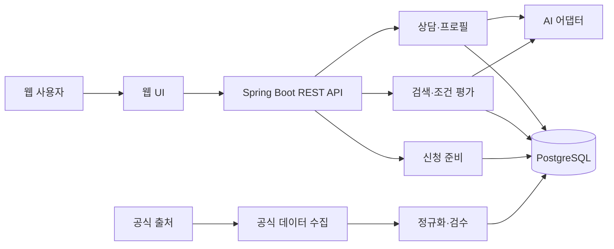

# 시스템 설계서

설계 버전: v0.1 · 작성일: 2026-11-25 · 상태: 구현 전 제안

## 1. 설계 방향

Spring Boot 단일 애플리케이션에서 상담, 검색, 조건 평가, 신청 준비를 모듈로 분리한다. PostgreSQL을 제안하며 프런트엔드와 AI 제공자는 미정이다. 기존 단발성 /api/recommendations 초안은 추가 질문을 이어가는 /api/v1/sessions 중심 계약으로 대체한다. 사용자 계정 대신 만료되는 익명 상담 세션에 정보를 임시 저장한다.

## 2. 모듈 책임

| 모듈 | 책임 |
|---|---|
| session | 생성·만료·삭제, 비밀 토큰 검증, 소유권 검사 |
| consultation | 메시지, 사실 추출 제안, 질문, 응답 처리 |
| profile | 확인된 사실, 필드별 상태, 프로필 버전 |
| program | 공식 출처, 공고 버전, 조건, 근거, 서류·절차 |
| recommendation | 후보 검색, 조건 평가, 근거 검증, 결과 스냅샷 |
| application | 준비 체크리스트와 사용자 기록 상태 |
| ingestion | 출처별 어댑터, 재시도, 중복 방지, 실행 기록 |

## 3. 상담과 질문 정책

자연어 추출 결과는 PROPOSED이며 사용자가 확인하기 전에는 자격 판단에 쓰지 않는다. 이름은 추천에 필요하지 않으므로 구조화된 필수 항목으로 수집하지 않는다. “25살”만으로 생년월일이나 만 나이를 역산하지 않는다. ageYears, ageBasis, ageAsOf를 함께 확인한다. 특정 기준일의 나이를 요구하는 공고는 필요한 정보를 별도 질문한다.

질문은 후보의 미확인 필수 조건을 기준으로 한 번에 하나씩, 상담당 기본 최대 10개를 제안한다. 여러 후보의 판단에 쓰이는 질문을 우선하고 건너뛴 질문은 자동 반복하지 않는다. 건너뛰기는 부정 응답이 아니다. 사용자는 언제든 현재 정보로 결과를 볼 수 있다. 모든 개인 정보를 채우는 대신 관련 후보 판단에 필요한 정보만 수집한다.

AI는 추출·질문 표현·근거 요약을 담당한다. 확인된 사실 저장, 수치 비교, 접수일 계산, 최종 상태 결정은 서버가 담당한다. 모델 출력은 허용 필드·자료형·공고 ID·문단 ID로 검증한다. 공고 본문은 신뢰하지 않는 데이터로 취급하며 그 안의 명령문은 실행하지 않는다.

## 4. 조건 평가

각 조건은 PASS / FAIL / UNKNOWN으로 평가한다. 구조화되지 않았거나 근거가 없는 조건은 UNKNOWN이다. 조건은 ALL과 ANY 그룹을 가진 트리다. ALL은 하나라도 FAIL이면 FAIL, 전부 PASS면 PASS, 나머지는 UNKNOWN이다. ANY는 하나라도 PASS면 PASS, 전부 FAIL이면 FAIL, 나머지는 UNKNOWN이다. 그룹을 중첩해 대체 조건을 표현한다. 제외 요건은 허용 조건으로 정규화하거나 검수 전까지 UNKNOWN으로 유지한다.

| 자격 상태 | 기준 | 화면 |
|---|---|---|
| POTENTIALLY_ELIGIBLE | 검수된 필수 조건 전부 PASS, 조건 추출 완전 | 입력 정보 기준 조건 충족 가능 |
| NEEDS_INFO | UNKNOWN 존재, 조건 누락·검수 미완료 | 추가 확인 필요 |
| INELIGIBLE | 필수 조건 트리 결과 FAIL | 확인된 조건 불일치 |

소득은 개인/가구, 세전/세후, 월/연, 소득인정액 등 기준이 일치할 때만 비교한다. 월급으로 소득인정액이나 기준 중위소득 충족을 추정하지 않는다. 실거주지와 주민등록지는 별개다. 동시 수급 제한을 확인할 수 없으면 UNKNOWN이다.

접수 상태 OPEN / UPCOMING / CLOSED / UNKNOWN은 자격 상태와 별개다. 날짜 미상·예산 소진형은 OPEN으로 단정하지 않는다. 마감일이 날짜만 있으면 시간 미확인으로 표시하고 해당 날짜가 지난 뒤 CLOSED로 처리한다. 공고의 시간대를 우선하며 기본 해석은 Asia/Seoul이다.

기본 추천은 INELIGIBLE 및 CLOSED를 제외한다. 자격 상태, 근거 신선도, 관심 분야, 확인된 마감 임박 순으로 정렬한다. 수급 보장 점수는 만들지 않는다. 평가 시각·프로필 버전·공고 버전을 저장하고 프로필 또는 공고 변경 시 기존 결과에 stale: true를 표시한다.

## 5. 수집과 근거

연동 후보는 온통청년, 정부24 관련 공개 데이터, 복지로 및 지자체 공식 공고다. API 제공 여부·이용 조건·필드·호출 한도는 연동 전 확인할 미결정 사항이다. 현재 어떤 출처도 연동 완료로 간주하지 않는다.

- (source_id, external_id)로 출처 내 공고를 식별하며 모집 회차가 다르면 별도 공고로 저장한다.
- 본문 해시가 변하면 새 불변 버전을 만들고 조건·문단·서류·절차를 연결한다.
- 출처 간 유사 공고는 자동 삭제하지 않고 검수 후 대표 공고를 결정한다.
- 버전 전체가 유효할 때 한 트랜잭션으로 최신 버전을 전환한다. 기존 추천의 참조는 유지한다.
- 실패 시 직전 성공 데이터를 유지하고 마지막 수집 성공·원문 확인 시각을 구분한다.
- 기본 수집 주기 24시간, 48시간 이상 확인 실패 시 오래된 정보 배지는 제안값이다.
- 허용된 공식 호스트만 수집하고 사설망·로컬 주소 및 비허용 리다이렉트를 차단한다.

## 6. 요청 처리와 장애

MVP 추천은 동기 요청이다. 전체 처리 상한 제안은 30초이며 초과 시 504를 반환한다. 외부 AI 호출 동안 DB 트랜잭션을 유지하지 않는다. 메시지를 멱등하게 등록하고 AI 실패 시 실패 상태를 기록한 뒤 같은 키로 재시도한다. 추천 저장 직전에 프로필 버전을 재검사하고 변경됐으면 409를 반환한다.

AI 장애 시 검색·상세를 유지하고 상담은 재시도를 안내한다. 빈 검색 결과와 출처 장애를 구분한다. 신청 준비는 공식 절차를 기반으로 하며 실제 기관 제출 기능은 포함하지 않는다.
