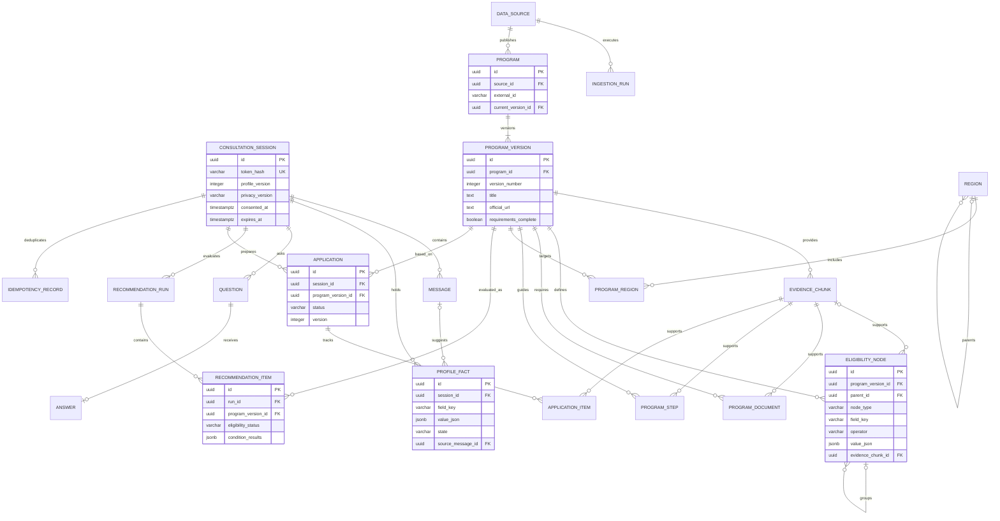

# ERD 및 데이터 사전

v0.1 · 2026-11-25 · PostgreSQL 기준 논리 설계. 실제 마이그레이션은 아직 없다.

## 1. 관계도

관계도에는 주요 속성만 표시했다. 전체 컬럼은 아래 데이터 사전을 기준으로 한다.

## 2. 共通規則

표의 `?`는 NULL 허용, 나머지는 NOT NULL이다. 주키는 region을 제외하고 UUID다. 시각은 timestamptz, 날짜는 date, 금액은 정수 원 단위(bigint), 프로필 값은 타입 검증을 거친 jsonb다. 모든 테이블은 기본적으로 created_at을, 수정 가능한 테이블은 updated_at을 가진다. 아래는 논리 타입이며 varchar 길이는 구현 시 확정한다.

## 3. 상담 데이터

| 테이블 | 컬럼 | 제약·설명 |
|---|---|---|
| consultation_session | id, token_hash, profile_version:int, privacy_version:text, consented_at, expires_at, created_at | token_hash UNIQUE, profile_version>=1, expires_at>created_at. 상태 ACTIVE는 만료 여부로 계산; 삭제·만료 정보는 영구 행으로 남기지 않음 |
| message | id, session_id FK, question_id? FK, role, content:text, processing_status, created_at | USER/ASSISTANT; PENDING/SUCCEEDED/FAILED. content는 최소한의 원문, 로그 전송 금지 |
| profile_fact | id, session_id FK, field_key, value_json?, state, source_message_id? FK, confirmed_at?, updated_at | UNIQUE(session_id,field_key). PROPOSED/CONFIRMED/UNKNOWN/SKIPPED. UNKNOWN/SKIPPED는 value=null |
| question | id, session_id FK, field_key, text, reason, input_type, options_json?, profile_version:int, state, created_at | PENDING/ANSWERED/SKIPPED/UNKNOWN/SUPERSEDED. 생성 당시 프로필 버전 |
| answer | id, question_id FK, value_json?, status, created_at | question_id UNIQUE. ANSWERED/UNKNOWN/SKIPPED; 뒤 두 상태는 null |
| idempotency_record | id, session_id FK, method, path, key, request_hash, state, response_status?, response_json?, expires_at | UNIQUE(session_id,method,path,key). PROCESSING/SUCCEEDED/RETRYABLE_FAILED |

프로필 필드·자료형의 기준은 [API 필드 사전](api-spec.md#프로필-필드-사전)이다. 스키마 없는 임의 개인정보 저장소로 사용하지 않는다. 기존 CONFIRMED 값과 새 추출이 충돌하면 기존 값을 유지하고 응답에서만 변경 후보를 제시한다.

프로필 변경과 version 증가는 하나의 트랜잭션이다. 응답 처리 대상 질문은 완료 상태로 만들고 나머지 PENDING 질문은 SUPERSEDED로 만든다. 부분 UNIQUE 인덱스로 세션당 PENDING 질문을 최대 하나만 허용한다. profile_fact는 현재 값만 보유하고 과거 판단에 필요한 값은 recommendation_run의 스냅샷으로 보존한다. 질문·메시지·사실의 참조 대상은 같은 세션이어야 한다.

## 4. 공고·근거 데이터

| 테이블 | 컬럼 | 제약·설명 |
|---|---|---|
| data_source | id, name, base_url, enabled:boolean, last_successful_sync_at? | 출처 설정, 인증키는 저장하지 않음 |
| ingestion_run | id, source_id FK, started_at, finished_at?, status, processed_count:int, failed_count:int, error_code? | RUNNING/SUCCEEDED/PARTIAL/FAILED, 건수>=0 |
| program | id, source_id FK, external_id, current_version_id? FK | UNIQUE(source_id,external_id). 적재 중만 current_version_id null, 공개 조회에서는 제외 |
| program_version | id, program_id FK, version_number:int, content_hash, title, agency, category, summary?, benefit_text?, raw_text, official_url, application_url?, period_type, start_date?, end_date?, starts_at?, ends_at?, timezone, period_raw_text?, verification_status, requirements_complete:boolean, last_verified_at?, created_at | UNIQUE(program_id,version_number). DRAFT/REVIEWED. period_type FIXED/ROLLING/UNKNOWN |
| evidence_chunk | id, program_version_id FK, ordinal:int, text | UNIQUE(program_version_id,ordinal), ordinal>=1 |
| eligibility_node | id, program_version_id FK, parent_id? FK, ordinal:int, node_type, field_key?, operator?, value_json?, evidence_chunk_id? FK | ALL/ANY/RULE. 그룹은 규칙 필드 null, RULE은 field/operator/value/evidence 필수 |
| program_document | id, program_version_id FK, name, description?, required:boolean?, evidence_chunk_id FK | required null은 필수 여부 미확인 |
| program_step | id, program_version_id FK, ordinal:int, title, description?, url?, evidence_chunk_id FK | UNIQUE(program_version_id,ordinal) |
| region | code:text PK, parent_code? FK, name | 국가·시도·시군구 계층. 코드 체계·전국 코드 값은 데이터 소스 연동 시 확정 |
| program_region | program_version_id FK, region_code FK | 복합 PK(program_version_id,region_code), 전국도 명시적인 코드 행 사용 |

공고 버전은 공개 후 불변이다. 정정·검수 변경도 새 버전을 생성한다. 같은 내용 재수집 시 버전을 늘리지 않고 출처 수집 성공 시각만 갱신한다. last_verified_at은 해당 버전의 내용을 확인한 시각이며 수집 성공과 구분한다.

program.current_version_id는 반드시 같은 program_id에 속해야 한다. `(program_id,current_version_id)`에서 program_version의 `(program_id,id)`로 복합 FK를 설정한다. 순환 참조는 초기 null로 적재 후 같은 트랜잭션에서 최신 포인터를 설정한다.

조건 트리는 버전별 루트 최대 하나, 순환 없음, RULE은 자식 없음, 그룹은 자식 한 개 이상을 검증한다. 부모·근거·서류·절차는 같은 버전에 속해야 하며 복합 FK와 게시 전 검증으로 보장한다. 조건이 없거나 추출이 불완전하면 requirements_complete=false다. 루트가 비어 있다고 전부 충족으로 판정하지 않는다.

## 5. 추천·신청 준비 데이터

| 테이블 | 컬럼 | 제약·설명 |
|---|---|---|
| recommendation_run | id, session_id FK, profile_version:int, profile_snapshot:jsonb, filters_json:jsonb, coverage_json:jsonb, evaluated_at, empty_reason? | 평가에 사용한 확인 정보·범위·필터의 스냅샷. NO_MATCH/NO_DATA |
| recommendation_item | id, run_id FK, program_version_id FK, rank:int, eligibility_status, recruitment_status, reasons_json:jsonb, missing_fields_json:jsonb, condition_results:jsonb | UNIQUE(run_id,program_version_id), UNIQUE(run_id,rank). 조건별 결과·근거 문단 ID 저장 |
| application | id, session_id FK, program_version_id FK, status, version:int, created_at, updated_at | UNIQUE(session_id,program_version_id). PREPARING/SUBMITTED_BY_USER/CANCELLED |
| application_item | id, application_id FK, type, ordinal:int, title, description?, evidence_chunk_id FK, completed:boolean, completed_at? | DOCUMENT/STEP, UNIQUE(application_id,ordinal). 미완료면 completed_at=null |

profile_snapshot과 condition_results의 jsonb는 API와 동일한 고정 스키마로 검증한다. 추천 결과에 저장된 근거 ID가 해당 program_version에 있는지 저장 전 검증한다. 신청 체크리스트는 생성 시 해당 버전의 서류·절차를 복사하고 원문 근거를 연결한다. 별도 업로드 파일 테이블은 MVP에 두지 않는다.

stale은 저장하지 않고 현재 profile_version과 공고 최신 버전으로 계산한다. 신청 준비의 stale은 공고 버전만 비교한다. 추천·신청 준비가 참조하는 공고 버전은 삭제하지 않고 보존한다.

## 6. 인덱스·삭제·일관성

- 상담: token_hash UNIQUE, expires_at, message(session_id,created_at,id), question(session_id,state).
- 공고: program(source_id,external_id) UNIQUE, program_version(program_id,version_number) UNIQUE, program_region(region_code,program_version_id), program_version(category,created_at,id).
- 검색: 초기 제목·본문 검색 전략은 실제 데이터량으로 결정하며 임베딩·벡터 저장은 후속이다.
- 추천: recommendation_run(session_id,evaluated_at,id), recommendation_item(run_id,rank) UNIQUE.
- 신청: application(session_id,created_at,id), application_item(application_id,ordinal) UNIQUE.
- session 삭제는 메시지·사실·질문/답변·추천/항목·신청/항목·멱등 기록에 CASCADE 적용한다. 메시지의 선택적 연결은 삭제 순서를 고려해 SET NULL을 사용한다.
- 공개 공고·출처 FK는 기본 RESTRICT로 과거 근거 손실을 방지한다. 공고 중단은 삭제 대신 노출 정책으로 처리한다.
- profile_version·application.version은 낙관적 잠금에 사용한다. 항목 변경도 부모 application.version을 증가시킨다.
- 개인정보 없는 운영 지표만 상담 삭제 이후 남긴다. 별도 사용자 계정·로그인 비밀번호 테이블은 MVP에 없다.
